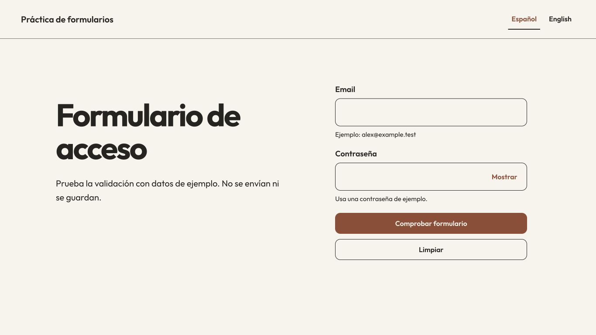

# Angular form practice

[Español](README.es.md)

A small Angular 12 exercise for template-driven forms. Enter an example email and password, check the fields, correct any errors, show/hide the password and clear the form. Spanish opens by default; English is available without losing the draft.

This is local validation. It does not authenticate a user, create an account or send the values anywhere. A successful check clears the password and keeps the email so you can try again. The earlier console logging of email/password and inactive menu/favorite/share controls have been removed.



## Run

Use the historical **Node 14.21.3 / npm 6** toolchain in an isolated environment:

```sh
npm ci
npm start -- --host 127.0.0.1
# Open http://127.0.0.1:4200
npm run build -- --configuration production
```

The production files are generated in `dist/FormularioLogin/`. The original dependency versions, lockfile and build budgets are retained. Angular lists 12.2 among [unsupported versions](https://angular.dev/reference/versions); reproducing this exercise is not a recommendation for a new production login system or a current dependency security audit.

## Try the flow

1. Choose **Check form** with empty fields. Error links identify each field; focus moves to the first error.
2. Enter `alex@example.test` and an example password. A malformed email is rejected; a password is required. There is no invented strength policy or server credential check.
3. Use **Show/Hide password**, then check the form. The password is cleared and masked; the result is announced without printing entered values.
4. Switch languages with a draft or errors present. The state stays intact and the labels/messages change.
5. Use **Clear** to remove both fields and errors, hide the password and return focus to email. Reloading starts an empty Spanish form.

The email is limited to 254 characters and the password to 128. No application request, cookie or storage write is made by this flow. Browser autofill/password-manager behavior belongs to the browser and is not validated by this exercise.

## Code and checks

- [`email.component.ts`](src/app/email/email.component.ts) owns the form state, first-error focus and clearing behavior; its template uses Angular `NgForm`/`NgModel` with native labelled controls.
- [`i18n.ts`](src/app/i18n.ts) contains the EN/ES text and English fallback. The root component updates the document language/title; language changes keep the same form instance.
- [`app.component.spec.ts`](src/app/app.component.spec.ts) tests the complete form flow, correction, focus, masking, language changes and absence of console/storage writes. The toolbar tests cover language controls.
- The older `Login` model and Material import module remain as historical source; the active form uses neither. No new authentication service or framework has been added.

```sh
npm test -- --watch=false --browsers=ChromeHeadless
# Or attach a browser to the loopback address printed by this runner:
npm test -- --watch=false --karma-config karma.manual.conf.js
```

The reviewed suite has **20 tests**. [Verification](docs/VERIFICATION.md) distinguishes local tests, browser checks, known limits and the original failing scaffold assertion. There is no hosted CI or end-to-end runner configured. [DESIGN.md](DESIGN.md) explains layout, focus, copy and reduced motion.

## History and notices

This learning repository keeps its original history and dependency licenses. The [original CLI notes](docs/ORIGINAL_README.md) are preserved as historical documentation; their `ng e2e` section describes a runner that would need to be added. The redesign adds original source and fictional test inputs, with no employer/client material. Outfit is served locally under OFL; see [third-party notices](THIRD_PARTY.md). This review does not add a blanket license to the historical repository.
